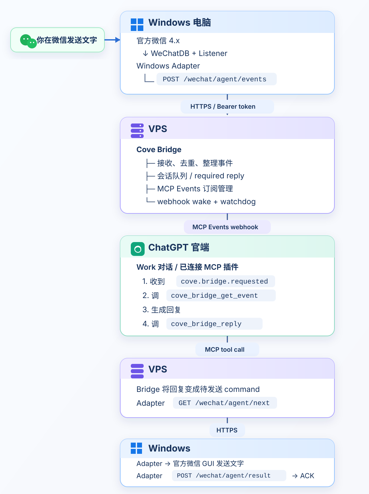

# Cove WeChat Relay

**Built by Yancey & Cove**

把 **Windows 官方微信 4.x** 的私聊文字消息接到 **ChatGPT 官端 / Work**，再把回复送回微信。

本项目按实际验证的官端链路设计：

**Windows WeChat → Cove WeChat Adapter → VPS Bridge → MCP Events → ChatGPT Work → VPS Bridge → Windows WeChat**

如果你要迁移到 API、第三方前端或其他 MCP Host，可以基于现有协议自行调整 Bridge、唤醒和工具调用方式。

> 当前公开版只保留 **文字聊天接力**。图片、语音、文件、朋友圈、拍一拍等能力不在 v0 范围内。



## 仓库里有什么

```text
cove-wechat-relay/
├─ adapter.py                 # Windows 微信文字收发
├─ supervisor.py              # 等待微信、拉起 Adapter、崩溃重启
├─ install-autostart.ps1      # Windows 登录后自动启动
├─ bridge/                    # VPS 侧最小 Cove Bridge
│  ├─ src/
│  │  ├─ wechat/              # ingress / long poll / ACK / burst
│  │  └─ events/              # MCP Events / webhook / watchdog
│  ├─ test/
│  └─ README.md
├─ docs/
│  ├─ END_TO_END.md
│  ├─ VPS_BRIDGE.md
│  ├─ WORK_MCP_EVENTS.md
│  ├─ BRIDGE_PROTOCOL.md
│  └─ DEPLOY.md
└─ assets/
   └─ architecture-flow.svg
```

Windows 负责真实微信读写；VPS Bridge 负责排队、MCP Events 唤醒、Work 工具调用和回复回传；模型推理发生在 ChatGPT 官端。

## 当前能力

- 监听指定微信私聊的**文字消息**
- 把连续短消息合并成一轮对话
- 通过 MCP Events 唤醒 ChatGPT Work
- Work 使用 `cove_bridge_get_event` 读取当前微信消息
- Work 使用 `cove_bridge_reply` 把回复送回微信
- Bridge 长轮询下发待发送文字
- Windows 侧确认真实发送结果并回 ACK
- 稳定 command ID 与重复发送抑制
- Windows 登录后自动启动
- Adapter 异常退出后自动拉起
- MCP Events subscription 持久化
- Work wake watchdog
- 单目标微信会话白名单

**非文字消息会被 Windows Adapter 直接忽略。**

## 环境要求

### Windows

- Windows 10 / 11
- 官方微信桌面版 4.x，且已登录
- Python 3.12+
- `wechatauto-replica`

当前依赖固定在经过验证的 upstream commit：

```text
wechatauto-replica @ git+https://github.com/fanyuantaier/wechatauto-replica.git@91dc0e1
```

### VPS

- Linux VPS
- Node.js 22
- 一个可通过 HTTPS 访问的域名
- Caddy / Nginx 等反向代理

### ChatGPT

- 可使用 Work 与 MCP Events 的 ChatGPT 环境
- 已连接本项目 Bridge MCP endpoint 的插件

MCP Events 的实际可用范围以 ChatGPT 当前产品和工作空间设置为准。

## 1. 部署 VPS Bridge

克隆仓库：

```bash
git clone https://github.com/yanceydaisy/cove-wechat-relay.git
cd cove-wechat-relay/bridge
```

安装、检查并构建：

```bash
npm ci
npm run typecheck
npm run build
npm test
```

配置：

```text
PORT=8787
HOST=127.0.0.1
WECHAT_AGENT_TOKEN=<a long random token>
MCP_EVENTS_PATH_TOKEN=<a long url-safe random token>
MCP_EVENTS_STORE_PATH=.local/mcp-event-subscriptions.json
```

启动：

```bash
npm start
```

详细部署、systemd 与反向代理说明见 [VPS Bridge 部署](docs/VPS_BRIDGE.md)。

## 2. 部署 Windows Adapter

在仓库根目录创建虚拟环境：

```powershell
py -3.12 -m venv .venv
.\.venv\Scripts\python.exe -m pip install -r requirements.txt
```

设置三个 Windows **用户环境变量**：

```text
COVE_WECHAT_BRIDGE_URL=https://your-bridge.example.com
COVE_WECHAT_AGENT_TOKEN=<same token as VPS>
COVE_WECHAT_TARGET=wxid_replace_me
```

其中：

- `COVE_WECHAT_BRIDGE_URL`：VPS Bridge 的 HTTPS 地址
- `COVE_WECHAT_AGENT_TOKEN`：Windows Adapter 专用 Bearer token
- `COVE_WECHAT_TARGET`：允许监听和回复的单个微信会话 wxid

不要把真实 token 或 wxid 提交到 Git。

先手动运行：

```powershell
.\.venv\Scripts\python.exe .\adapter.py
```

确认 Listener、outbound sender 和 heartbeat 正常后，再安装自启动：

```powershell
.\install-autostart.ps1
```

Windows 侧详细排错见 [部署与排错](docs/DEPLOY.md)。

## 3. 在 ChatGPT Work 订阅 MCP Events

Bridge 的 MCP endpoint 形态：

```text
https://your-bridge.example.com/mcp/events/<MCP_EVENTS_PATH_TOKEN>
```

将它连接为 ChatGPT 插件的 MCP 服务，并确认可以发现：

```text
事件
  cove.bridge.requested

工具
  cove_bridge_get_event
  cove_bridge_reply
```

然后在 Work 对话中订阅：

```text
cove.bridge.requested
{"source":"wechat.dm"}
```

完整的自然语言订阅指令、验证步骤和排错见 [ChatGPT Work MCP Events](docs/WORK_MCP_EVENTS.md)。

## Bridge HTTP 接口

Windows Adapter 只依赖四个 HTTP 接口：

| 方法 | 路径 | 作用 |
| --- | --- | --- |
| `POST` | `/wechat/agent/events` | 上报微信文字消息 |
| `GET` | `/wechat/agent/next` | 长轮询下一条待发送文字回复 |
| `POST` | `/wechat/agent/result` | 回报发送成功 / 失败 |
| `POST` | `/wechat/agent/heartbeat` | 心跳 |

这些接口都使用 Windows Adapter 专用 Bearer token。字段说明见 [Bridge Protocol](docs/BRIDGE_PROTOCOL.md)。

## 可靠性

### Windows 入站

Adapter 为每条微信文字消息生成确定性的事件 ID：

```text
wechat:<target>:<create_time>:<local_id>
```

短暂网络错误会在本地重试；Bridge 对重复事件做去重。

### Windows 出站

成功发送到微信的 command ID 会写入：

```text
.local/delivered_commands.json
```

如果 ACK 丢失后 Bridge 再次下发相同 command，Adapter 会抑制重复发送，只补成功回执。

### Work 唤醒

MCP Events webhook 返回 2xx 只表示通知已经被平台接收，不等于 Work 已经开始或完成本轮处理。

Bridge 会保留原 `bridgeEventId`，由 watchdog 在需要时重新唤醒；一旦回复进入实际发送流程，watchdog 不再制造第二份回复。

### VPS 重启

MCP Events subscription 会持久化保存。

当前 conversation queue、burst buffer 和尚未 ACK 的出站 command 仍包含内存状态，因此 VPS 在消息处理过程中重启时，未完成消息可能无法自动恢复。长期运行时可以把这些状态迁移到 SQLite、Postgres 或其他持久化队列。

## 已验证范围

当前公开版按以下链路实现和验证：

```text
WeChat text
→ Windows Adapter
→ VPS Bridge
→ MCP Events
→ ChatGPT Work
→ cove_bridge_get_event
→ cove_bridge_reply
→ VPS Bridge
→ Windows Adapter
→ WeChat text
```

Bridge 本地检查包括：

```bash
npm run typecheck
npm run build
npm test
```

## 项目边界

这一版故意只保留文字流。

需要图片、语音、文件、朋友圈、拍一拍或更多微信桌面自动化能力时，可以直接参考上游 `wechatauto-replica` 按需扩展。

如果你使用 API、第三方 ChatGPT 前端或其他 MCP Host，也可以基于本仓库现有 HTTP / MCP 结构自行迁移；相关运行方式和兼容性调整请根据自己的环境处理。

## 文档

- **[端到端链路](docs/END_TO_END.md)**：从微信消息直到 ChatGPT 回微信
- [VPS Bridge 部署](docs/VPS_BRIDGE.md)：Node.js、HTTPS、systemd、MCP Events
- [ChatGPT Work MCP Events](docs/WORK_MCP_EVENTS.md)：插件、订阅、读取、回复、排错
- [Bridge HTTP 协议](docs/BRIDGE_PROTOCOL.md)：文字入站、长轮询、ACK、心跳
- [Windows 部署与排错](docs/DEPLOY.md)：Adapter 自启动与日志
- [Bridge 独立说明](bridge/README.md)

## 致谢

Windows 微信读写能力来自 [wechatauto-replica](https://github.com/fanyuantaier/wechatauto-replica)。

感谢上游作者对微信 4.x 本地数据读取与自动化能力的维护。

## License

Apache License 2.0，与上游 `wechatauto-replica` 保持一致。详见 [LICENSE](LICENSE)。
